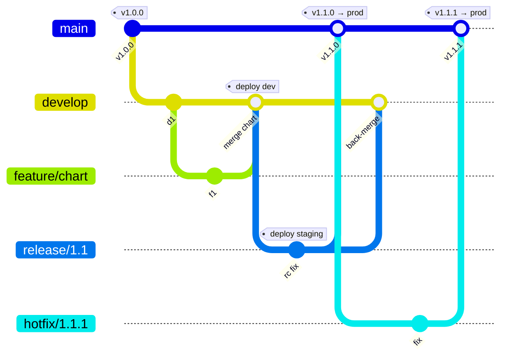

# Gitflow

Two long-lived branches: **`develop`** (integration) and **`main`** (what is in production). Features
branch off `develop`; releases are stabilised on `release/x.y` branches; urgent production fixes go on
`hotfix/x.y.z` branches off `main`. Every merge to `main` is a release and gets a tag.

## What runs when

| Event | CI (Phase 1–3) | CD (Phase 4–5) |
|---|---|---|
| PR to `develop` or `main` | test, build images (**no push**), scans | — |
| push to `develop` | test, build, scan, **push** | deploy to **dev** |
| push to `release/**` | same | deploy to **staging** (optional; off by default for cost) |
| push to `hotfix/**` | same | — (tested, then merged to `main`) |
| tag `vX.Y.Z` on `main` | build, push `vX.Y.Z` tag too | promote to **prod** (needs approval) |

## Why teams choose it

- Explicit release stabilisation and a clear place for hotfixes while `develop` moves on, which helps with
  scheduled releases or several supported versions.
- Costs: more branches, more merges (and back-merges), slower feedback, and more pipeline triggers to get
  right. Many teams that deploy continuously have moved to trunk-based for these reasons.
- Hotfix → `main` → tag → prod, then merge back into `develop`. Forgetting the back-merge reintroduces the bug
  in the next release.

## Enforcing it

Import `.github/rulesets-templates/gitflow.json` (+ `tags.json`): PRs required on `main` and `develop`,
merge commits (history shows where releases came from), `ci-ok` must pass, no force-push or deletion.

## Environments (Phase 4)

| Environment | Comes from | Gate |
|---|---|---|
| dev | `develop` | automatic |
| staging (optional) | `release/*` | automatic |
| prod | tag `vX.Y.Z` on `main` | required reviewer on the `prod` environment |

## Versions on each branch

`scripts/version.sh` derives `APP_VERSION` from the branch, so the UI always tells you where a build came from:
`1.1.0-develop.0a1b2c3`, `1.1.0-release-1.1.4d5e6f7`, and plain `1.1.0` for the tag `v1.1.0`.
