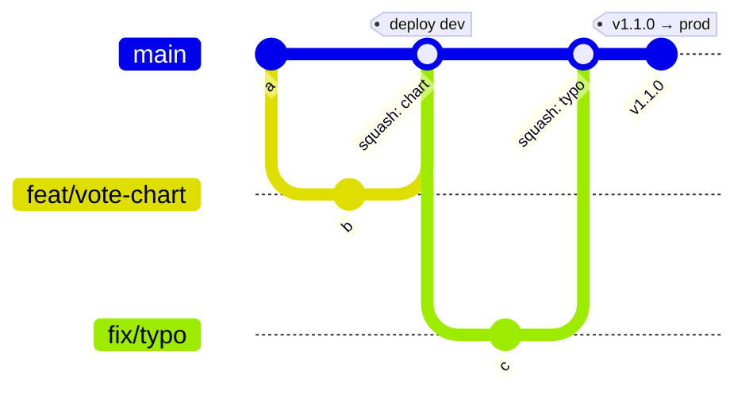

# Trunk-based development

Everyone integrates into **one branch** (`main`) through short-lived feature branches and pull requests,
at least daily. `main` is always releasable. A release is a **tag** on `main`.

## What runs when

| Event | CI (Phase 1–3) | CD (Phase 4–5) |
|---|---|---|
| PR to `main` | test, build images (**no push**), scans | — |
| push / merge to `main` | test, build, scan, **push** `sha-<12>` images | deploy to **dev** automatically |
| tag `vX.Y.Z` on `main` | build, push `vX.Y.Z` tag too | promote the **same digest** that passed dev to **prod** (needs approval) |

## Why teams choose it

- Small changes, fast feedback, few merge conflicts; one pipeline path to learn.
- Pairs naturally with **build once, promote the digest**: the artifact deployed to prod is byte-for-byte
  the one tested in dev.
- Needs discipline: a broken `main` blocks everyone, so the required `ci-ok` check matters, and unfinished
  work hides behind feature flags rather than long-lived branches.

## Enforcing it

Import `.github/rulesets-templates/trunk.json` (+ `tags.json`): PRs required, squash merges, linear history,
`ci-ok` must pass, no force-push or deletion of `main`, release tags immutable.

## Environments (Phase 4)

| Environment | Comes from | Gate |
|---|---|---|
| dev | every merge to `main` | automatic |
| prod | tag `vX.Y.Z` | required reviewer on the `prod` environment |
