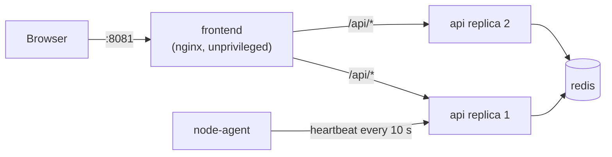

# Phase 0: Set up and meet PodPoll

> **Time:** about 45 minutes · **Cost:** $0 · **You finish with:** your own fork, PodPoll running on your
> laptop showing *your* commit, and an AWS budget alert ready for Phase 4.

## Objectives

- Fork the workshop repository the right way, so later phases (and catching up) work.
- Run PodPoll locally and learn to read it: every card tells you something about the platform.
- Understand **build provenance**: how an image knows which commit, branch and build produced it.
- Prepare your AWS account *safely*, with a budget alert, before anything costs money.

## Concepts

**PodPoll makes the platform visible.** It is a small voting app, but its real job is to show which build,
instance, environment and storage answered your request. Throughout the workshop you will change the platform
(pipelines, deployments, rollbacks) and *see* the result in the browser instead of trusting a log line.



**Build provenance.** When an image is built, the build stamps it with `APP_VERSION`, `GIT_SHA`, `GIT_REF`,
`BUILD_ID`, `BUILD_URL`, `CI_SYSTEM` and `BUILD_TIME` (`scripts/version.sh` computes them). The app shows
them in card 6, so you can always answer "what exactly is running here?". In Phase 1 your pipeline will
stamp them for you; today, `local/up.sh` stamps your local commit.

## Starting point

The `main` branch of the upstream repository. There is nothing to catch up on in Phase 0.

---

## Task 1: Fork and clone

**Goal:** your own copy on GitHub that you can push to and run Actions in.

1. On GitHub, open the upstream repository and click **Fork**.
   **Untick "Copy the `main` branch only"**, so the `solution/phase-N` branches come along (you may need them to catch up).
2. Clone **your fork** (not upstream), then add upstream as a second remote:

   ```bash
   git clone git@github.com:<you>/podpoll-cicd.git
   cd podpoll-cicd
   git remote add upstream https://github.com/StargazerZX/podpoll-cicd.git
   ```

3. In your fork on GitHub, open the **Actions** tab and enable workflows. Forks start with Actions disabled
   (and with scheduled workflows and Dependabot off, which matters in Phase 3).

<details><summary>Hint: I forked with "main only". Do I need to start over?</summary>

No. `git fetch upstream` gives you every upstream branch locally, and `labs/catch-up.sh` fetches the
solution branch it needs from `upstream` by itself.
</details>

<details><summary>Hint: my pull requests target the upstream repository</summary>

GitHub defaults a fork's PRs to the *parent* repository. When you open a PR, change **base repository** to
your fork. With the GitHub CLI: `gh repo set-default <you>/podpoll-cicd`.
</details>

> ⚠️ **Your fork is public.** Anything you commit, including a real secret pasted "just for a minute", is public
> and gets scraped within minutes. Phase 2 is about exactly this. Until then: never commit real credentials.

**Checkpoint:** `git remote -v` shows `origin` → your fork and `upstream` → StargazerZX.

---

## Task 2: Check your tools

You need: **Git**, **Docker** with the **Compose v2 plugin** (`docker compose version`), **curl**, **jq**, **python3**.
Give Docker at least 4 GB of memory.

Optional, for running the tests yourself: Python 3.12 or [uv](https://docs.astral.sh/uv/), and Node.js 20+.

**Checkpoint:** `docker run --rm hello-world` prints "Hello from Docker!".

---

## Task 3: Run PodPoll

```bash
local/up.sh dev
```

It builds the three images (api, frontend, node-agent), stamps them with your commit, and starts the stack.
Open **http://localhost:8081**.

**Checkpoint:** a green **env: dev** badge, an amber theme with a **FRONTEND v2** ribbon, and in card 6 your
current commit (compare with `git log -1 --format=%h`), **local build**, CI **local**.

<details><summary>Hint: "port is already allocated"</summary>

Something else uses port 8081. Edit `FRONTEND_PORT` in `local/env/dev.env`, or stop the other program.
</details>

<details><summary>Hint: "failed to create network ... COMMAND_FAILED"</summary>

A firewall hiccup on some Linux hosts (firewalld). Run the same command again.
</details>

---

## Task 4: Explore (each step shows you a platform behaviour)

Do these with the browser open next to your terminal.

1. **Vote** a few times. Card 1 counts, card 4 says where votes live (Redis, in memory).
2. **Load balancing.** Watch card 2's histogram: two API containers share the answers. Then:

   ```bash
   local/compose.sh dev up -d --scale api=3 --no-recreate     # local/compose.sh = docker compose for one env
   local/compose.sh dev restart frontend
   ```

   A third container joins the rotation. *Why the frontend restart?* nginx resolves the name `api` once at
   startup, so it only sees new replicas after a restart. (On Kubernetes and ECS the service name is stable, so no restart is needed.)
3. **Environments side by side.** `local/up.sh prod`, then open http://localhost:8082: a **red** badge and the
   v1 (sky blue) theme. Same code, different configuration. Try `local/up.sh staging` (port 8084):
   orange badge, v3 theme, and **card 7 "Release security"**, which shows a sample of what your Phase 3 pipeline will produce.
4. **Ask the API directly:**

   ```bash
   curl -s localhost:8081/api/info | jq
   curl -s localhost:8081/api/build | jq
   curl -s localhost:8081/version
   ```

5. **A bad release.** Restart dev with readiness broken:

   ```bash
   CHAOS_READY_FAIL=true CHAOS_ERROR_RATE=0.3 local/up.sh dev
   local/compose.sh dev ps        # after ~30 s the api containers are "unhealthy"
   ```

   The UI shows an orange **chaos** chip and some votes fail. Note `/healthz` (liveness) still answers. In
   Phase 4, a deployment like this must roll back automatically. Restore with `local/up.sh dev`.
6. **ECS mode, without AWS.** `local/up.sh ecs-sim` (port 8083) fakes the ECS task metadata endpoint: instances
   are now *tasks*, the "node" is an availability zone, and the Kubernetes-only RBAC card disappears.
7. **See what the pipeline will compute:** `scripts/version.sh`. Commit something and run it again: `GIT_SHA`
   and `APP_VERSION` change. Change a file without committing: `APP_VERSION` gets a `+dirty` suffix.

**Checkpoint:** you can explain what each of the cards 1–4 and 6 tells you, and why the badge colour
comes from the **API's** answer, not the frontend's.

Stop what you don't need: `local/down.sh prod`, `local/down.sh staging`, `local/down.sh ecs-sim`.

---

## Task 5: Prepare your AWS account (needed from Phase 4)

You will deploy to **your own** AWS account in Phases 4 and 5, so set up cost protection now, while nothing is running.

**Which plan are you on?**

- Accounts created **on or after 15 July 2025** choose a **Free plan** or a **Paid plan**. Both start with USD 100 in
  credits (up to 200 through onboarding activities, one of which is creating a budget).
  The Free plan never charges you, but the account **closes** when the credits run out or after 6 months,
  and only "select services" are available. AWS's own list of Free-plan services includes ECS, EKS, Elastic
  Load Balancing and ECR, but this workshop hasn't yet confirmed it with a live deploy on a Free-plan account
  (the Phase 4 guide will). If a service turns out to be blocked, upgrade to the Paid plan: your credits still
  apply, but billing starts once they are used up.
- Older accounts are on the legacy free tier **without credits**: Phases 4–5 cost real (small) money.
  Expect roughly $0.10–0.25 per hour while things run; every phase ends with a teardown.

**Create a budget alert** (Billing and Cost Management → Budgets → Create budget → *Monthly cost budget*,
USD 10, your e-mail). Or with the AWS CLI:

```bash
ACCOUNT=$(aws sts get-caller-identity --query Account --output text)
EMAIL=you@example.com
aws budgets create-budget --account-id "$ACCOUNT" \
  --budget '{"BudgetName":"podpoll-workshop","BudgetLimit":{"Amount":"10","Unit":"USD"},"TimeUnit":"MONTHLY","BudgetType":"COST","CostTypes":{"IncludeCredit":false}}' \
  --notifications-with-subscribers "[
    {\"Notification\":{\"NotificationType\":\"ACTUAL\",\"ComparisonOperator\":\"GREATER_THAN\",\"Threshold\":50,\"ThresholdType\":\"PERCENTAGE\"},\"Subscribers\":[{\"SubscriptionType\":\"EMAIL\",\"Address\":\"$EMAIL\"}]},
    {\"Notification\":{\"NotificationType\":\"FORECASTED\",\"ComparisonOperator\":\"GREATER_THAN\",\"Threshold\":100,\"ThresholdType\":\"PERCENTAGE\"},\"Subscribers\":[{\"SubscriptionType\":\"EMAIL\",\"Address\":\"$EMAIL\"}]}
  ]"
```

<details><summary>Why <code>IncludeCredit: false</code>?</summary>

With credits counted, your "spend" shows $0 while the credits quietly burn, and the alert only fires once they are
gone. Excluding credits makes the budget track what you actually use.
</details>

**Checkpoint:** the budget appears under Budgets, and `labs/check-phase-0.sh --aws` reports it.

---

## Jenkins (alternate path, coming later)

The main track uses **GitHub Actions**. A local Jenkins + SonarQube track that mirrors Phases 1–3 will be added
later as an optional alternate path. Nothing to do for it now.

---

## Check your work

```bash
local/up.sh dev
labs/check-phase-0.sh          # add --aws once you have done Task 5
```

Expected (warnings are fine, failures are not):

```text
1. Tools
✔ git found
...
2. Your fork
✔ origin = git@github.com:<you>/podpoll-cicd.git
✔ upstream remote set
✔ solution branches reachable
3. PodPoll running locally (http://localhost:8081)
✔ frontend answers
✔ API answers and Redis is reachable (env: dev)
✔ card 6 shows your current commit (0a1b2c3)

Phase 0 complete. Next: docs/labs/phase-1-basic-pipeline.md
```

## Clean up

```bash
local/down.sh dev        # and any other environment you started
```

## Stretch goals

- Run the test suites: `scripts/test.sh` (needs Python 3.12 or uv, Node.js, Docker for the Postgres tests).
- Run the browser smoke test: `scripts/test-e2e.sh` (runs Playwright in a container).
- Try Postgres mode: copy `local/env/prod-postgres.env.example` to `local/env/prod-postgres.env`, set a
  `DB_PASSWORD`, change `FRONTEND_PORT` if prod is running, and `local/up.sh prod-postgres`. Card 4 changes;
  votes now survive a restart of the api containers.
- Read `api/contracts/`: the JSON shapes your pipeline's smoke tests can rely on.
