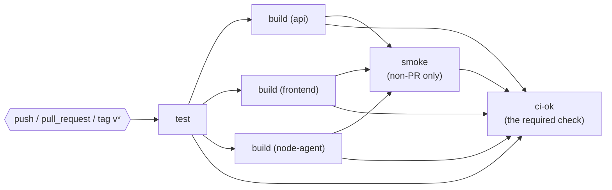

# Phase 1: Your first pipeline (test, build, push)

> **Time:** about 2 hours · **Cost:** $0 (public repositories get free GitHub-hosted runners and GHCR storage)
> · **You finish with:** a GitHub Actions workflow that tests every change, builds the three images with
> build provenance, pushes them to GitHub Container Registry with immutable tags, smoke-tests what it pushed,
> and a ruleset so nothing reaches `main` without passing.

## Objectives

- Read and write a workflow: **triggers**, **jobs**, **steps**, **runners**, job dependencies, a matrix.
- Build images with **build-args**, so every image can tell you which commit and which run produced it.
- Tag images **immutably** (`sha-<commit>`), never with a moving tag like `latest`.
- Authenticate to a registry with the built-in **`GITHUB_TOKEN`**, granting it the **least privilege** each job needs.
- Choose a **branching model** and enforce it with a **ruleset** and one required check.

## Concepts



- A **workflow** (`.github/workflows/*.yml`) reacts to **events** (`on:`). It runs **jobs** in parallel unless
  one `needs:` another. Each job gets a fresh VM (**runner**) and runs **steps**: shell commands (`run:`) or
  reusable **actions** (`uses:`).
- **`GITHUB_TOKEN`** is a short-lived token GitHub creates for every run. Its powers are set by `permissions:`.
  Start from **nothing** (`permissions: {}` at the top) and grant each job only what it needs, e.g.
  `packages: write` only for the job that pushes images.
- **Immutable tags.** `podpoll-api:sha-0a1b2c3d4e5f` always means the same bytes. A tag like `latest` or `2.0`
  can be moved, so "what's running?" no longer has an answer. Release tags `vX.Y.Z` are added on top (and Phase 1's
  `tags.json` ruleset stops anyone from moving them).
- **Pull requests build, but don't push.** A PR is untrusted until reviewed; its images go nowhere.
  (PRs from forks get a read-only token anyway.)

## Starting point

Your fork's `main` with Phase 0 done (`labs/check-phase-0.sh` passes). Work on a branch, e.g.
`git switch -c phase-1`, and open a pull request **against your own fork** when a task says so.

---

## Task 1: Choose a branching model

Read [docs/branching/](../branching/README.md) and decide: **trunk-based** (recommended) or **Gitflow**.
You'll import the matching ruleset in Task 6. The workflow you write supports both anyway.

**Checkpoint:** you can say which branch deploys to dev and what makes a release in your model.

---

## Task 2: A first workflow that runs the tests

Create `.github/workflows/ci.yml`:

```yaml
name: CI

on:
  pull_request:
  push:
    branches:
      - main
      # TODO (Gitflow): develop, release/**, hotfix/**
    tags:
      - "v*"

permissions: {}            # least privilege: grant per job below

jobs:
  test:
    runs-on: ubuntu-24.04  # a fixed runner image, not ubuntu-latest
    timeout-minutes: 15
    permissions:
      contents: read       # enough to check out the code
    steps:
      # TODO 1: check out the repository (actions/checkout), WITHOUT leaving the token in .git/config
      # TODO 2: install Python 3.12 (actions/setup-python)
      # TODO 3: install Node.js 24 (actions/setup-node), with no dependency cache
      # TODO 4: run every test suite: scripts/test.sh
```

**Pin every action to a full commit SHA**, with the version as a comment. A tag like `@v7` can be moved by
whoever controls the action's repository. In March 2026 that is exactly how a popular scanner action was
hijacked (Phase 3 tells the story). Find the commit behind a release tag:

```bash
git ls-remote https://github.com/actions/checkout.git 'refs/tags/v7.0.1^{}' 'refs/tags/v7.0.1'
# use the ^{} line if there is one (annotated tag), else the other
```

```yaml
      - uses: actions/checkout@<40-hex-commit-sha> # v7.0.1
```

Prefer a release that has been out for **at least a week**. Fresh releases are where compromises hide.

<details><summary>Hint 1: which inputs?</summary>

`actions/checkout` has `persist-credentials` (set it to `false`); `actions/setup-python` has `python-version`;
`actions/setup-node` has `node-version` and `package-manager-cache`. Read an action's `action.yml` at the commit
you pinned. It lists every input.
</details>

<details><summary>Hint 2: why no Node cache?</summary>

A cache that a pull request can write and a later publishing build reads can be *poisoned*. Nothing here needs a
cache, so turn it off: `package-manager-cache: false`.
</details>

<details><summary>Last resort</summary>

`git fetch upstream && git show $(git log upstream/solution/phase-1 --format=%h --grep='phase-1/step-1:')`
</details>

Commit, push your branch, open a PR **against your fork's `main`**.

**Checkpoint:** the PR shows a **CI / test** check. Click it: every suite ran, including the Postgres tests
in a container on the runner. If it's red, open the first red step, fix, push again.

---

## Task 3: Build the three images, with build provenance

Add a `build` job that runs **after** `test`, once per component, using a **matrix**:

```yaml
  build:
    name: build (${{ matrix.component }})
    needs: test
    runs-on: ubuntu-24.04
    timeout-minutes: 20
    permissions:
      contents: read
    strategy:
      fail-fast: false
      matrix:
        component: [api, frontend, node-agent]
    steps:
      # TODO 1: check out (as in test)
      # TODO 2: compute the provenance:  scripts/version.sh >> "$GITHUB_ENV"
      #         (makes APP_VERSION, GIT_SHA, ..., IMAGE_TAG available to later steps as env vars)
      # TODO 3: set up Buildx (docker/setup-buildx-action)
      # TODO 4: build ${{ matrix.component }}/ with docker/build-push-action, push: false for now,
      #         passing the build-args APP_VERSION GIT_SHA GIT_REF BUILD_ID BUILD_URL CI_SYSTEM BUILD_TIME SOURCE_URL
```

<details><summary>Hint 1: what does scripts/version.sh print on GitHub?</summary>

Run it locally with fake GitHub variables to see:

```bash
GITHUB_ACTIONS=true GITHUB_SHA=$(git rev-parse HEAD) GITHUB_REF=refs/heads/main GITHUB_REF_NAME=main \
GITHUB_RUN_NUMBER=7 GITHUB_RUN_ID=123 GITHUB_SERVER_URL=https://github.com GITHUB_REPOSITORY=you/podpoll-cicd \
scripts/version.sh
```
</details>

<details><summary>Hint 2: passing build-args</summary>

`build-args` is a multi-line string, one `NAME=value` per line, e.g. `APP_VERSION=${{ env.APP_VERSION }}`.
Inside `with:` the `${{ }}` syntax is fine. Inside `run:` scripts, use the environment variable (`"$APP_VERSION"`)
instead. Pasting `${{ }}` into a shell script is how *template injection* happens (Phase 3).
</details>

<details><summary>Hint 3: faster rebuilds</summary>

`cache-from: type=gha,scope=${{ matrix.component }}` and `cache-to: type=gha,mode=max,scope=${{ matrix.component }}`
reuse layers between runs.
</details>

<details><summary>Last resort</summary>

`git show $(git log upstream/solution/phase-1 --format=%h --grep='phase-1/step-2:')`
</details>

**Checkpoint:** three `build (…)` checks on your PR, all green.

---

## Task 4: Push to GitHub Container Registry, only from trusted events

Now publish, but **not** from pull requests:

1. Give **only this job** `packages: write`.
2. Log in to `ghcr.io` with `docker/login-action`: user `${{ github.actor }}`, password `${{ secrets.GITHUB_TOKEN }}`.
   Skip the login on pull requests (`if: github.event_name != 'pull_request'`).
3. Name the image `ghcr.io/<owner>/podpoll-<component>`. **Registry paths must be lowercase**, and your
   GitHub name may not be (`${OWNER,,}` lowercases a bash variable).
4. Tag it `…:${IMAGE_TAG}` (that's `sha-<12 hex>` from `version.sh`), plus `…:vX.Y.Z` when the run is for a tag
   (`GITHUB_REF_TYPE == tag`, the tag is in `GITHUB_REF_NAME`).
5. `push: ${{ github.event_name != 'pull_request' }}`
6. Optional but nice: write the image, tags and digest to `$GITHUB_STEP_SUMMARY`.

<details><summary>Hint: several tags in one step</summary>

`tags:` takes one tag per line. Build the list in a `run:` step and pass it through `$GITHUB_ENV` with the
multi-line syntax:

```bash
{ echo "TAGS<<EOF"; echo "$tags"; echo "EOF"; } >> "$GITHUB_ENV"
```
</details>

<details><summary>Last resort</summary>

`git show $(git log upstream/solution/phase-1 --format=%h --grep='phase-1/step-3:')`
</details>

Merge your PR into `main` (the push to `main` is what publishes).

**Checkpoint:** your GitHub profile → **Packages** shows `podpoll-api`, `podpoll-frontend`, `podpoll-node-agent`,
each linked to your repository (the `org.opencontainers.image.source` label in the Dockerfiles does that) with a
`sha-…` tag. Packages pushed from a **public** repository's workflow come out public: check with
`docker manifest inspect ghcr.io/<you-lowercase>/podpoll-api:sha-<12 hex>` without logging in.

---

## Task 5: Smoke-test what you pushed

A green build proves the image *built*. Prove it **runs**, using the exact images from the registry:

```yaml
  smoke:
    name: smoke (pushed images)
    needs: build
    if: github.event_name != 'pull_request'     # nothing was pushed for a PR
    runs-on: ubuntu-24.04
    timeout-minutes: 10
    permissions:
      contents: read
      packages: read
    steps:
      # TODO 1: check out, and compute the provenance again (each job is a fresh VM)
      # TODO 2: log in to ghcr.io (the packages might be private)
      # TODO 3: start PodPoll from the registry:
      #   IMAGE_REGISTRY=ghcr.io/<owner-lowercase> docker compose -p podpoll-ci \
      #     -f local/compose.yaml -f local/compose.registry.yaml --env-file local/env/dev.env up -d --wait
      # TODO 4: scripts/smoke-test.sh http://localhost:8081 --expect-sha "$GIT_SHA" --expect-env dev
      # TODO 5 (if: failure()): print the container logs
```

`--expect-sha` fails unless **both** tiers report this commit: the classic "the deploy worked but we're still
running the old version" bug, caught in CI.

<details><summary>Last resort</summary>

`git show $(git log upstream/solution/phase-1 --format=%h --grep='phase-1/step-4:')`
</details>

**Checkpoint:** on `main`, a green **smoke (pushed images)** job; its log ends with `PASS`.

---

## Task 6: One required check, and a ruleset that enforces it

Rulesets require checks **by name**. Requiring `test`, `build (api)`, `build (frontend)` … breaks every time you
rename or add a job. Instead, add one last job, `ci-ok`, that `needs:` all the others and **fails unless they all
passed**:

```yaml
  ci-ok:
    name: ci-ok
    needs: [test, build, smoke]
    if: always()          # TODO: why is this essential? (see the hint)
    runs-on: ubuntu-24.04
    timeout-minutes: 2
    permissions: {}
    steps:
      - name: Did every required job pass?
        env:
          TEST: ${{ needs.test.result }}
          # TODO: BUILD, SMOKE, and the event name
        run: |
          # TODO: exit 1 unless test and build are "success",
          #       and smoke is "success" (or "skipped", but only on a pull request)
```

<details><summary>Hint: why <code>if: always()</code>?</summary>

Without it, when `test` fails, `ci-ok` is **skipped**, and a skipped required check counts as **passing**. Your
broken PR would be mergeable. With `always()`, `ci-ok` runs, sees `test=failure`, and fails.
</details>

<details><summary>Last resort</summary>

`git show $(git log upstream/solution/phase-1 --format=%h --grep='phase-1/step-5:')`
</details>

Once `ci-ok` has run, protect your branches. In your fork: **Settings → Rules → Rulesets → New ruleset →
Import a ruleset**, and import:

- `.github/rulesets-templates/trunk.json` **or** `gitflow.json` (from Task 1)
- `.github/rulesets-templates/tags.json` (release tags can't be moved or deleted)

Read [`.github/rulesets-templates/README.md`](../../.github/rulesets-templates/README.md) for what each rule does.

**Checkpoint:**
1. `git push origin main` with a direct commit is **rejected** (`GH013: Repository rule violations`).
2. Open a PR that breaks a test (e.g. change an expected value in `api/tests/test_api.py`): `ci-ok` fails and
   **Merge** is blocked. Close it.

---

## Task 7: See it (the reason we did all this)

Run the images **your pipeline built**, not local builds:

```bash
IMAGE_REGISTRY=ghcr.io/<you-lowercase> IMAGE_TAG=sha-<first 12 chars of a main commit> \
  docker compose -p podpoll-ci -f local/compose.yaml -f local/compose.registry.yaml \
  --env-file local/env/dev.env up -d
```

Open http://localhost:8081. Card 6 now shows **github-actions**, the **run number** (it links to the run), the
commit (links to it), and how long ago CI built it. That is build provenance: from any running copy of PodPoll
you can get back to the exact commit and pipeline run.

**Checkpoint:** card 6 says `github-actions` and `#<run number>`. Stop it with
`docker compose -p podpoll-ci -f local/compose.yaml down`.

---

## Task 8 (small): CODEOWNERS

Create `.github/CODEOWNERS` naming yourself as owner of everything, and especially of `.github/`. On a team,
"Require review from Code Owners" in the ruleset then means nobody changes the pipeline without its owners'
approval, which matters because the pipeline holds the keys to production. (Alone, you can't approve your own PR,
so leave that option off in your fork.)

---

## Gitflow notes

- Add `develop`, `release/**` and `hotfix/**` to the push triggers (the solution has them).
- Import `gitflow.json` instead of `trunk.json`; it protects `main` **and** `develop`.
- `version.sh` names builds after the branch: `1.0.0-develop.0a1b2c3`, `1.0.0-release-1.1.4d5e6f7`.

## Jenkins (alternate path, coming later)

A Jenkins track (a declarative `Jenkinsfile`: Checkout → Test → Build → Push to a local registry) will be added
later as an optional alternate path. Card 6 will then say `jenkins`.

## Check your work

```bash
git switch main && git pull
labs/check-phase-1.sh
```

Expected:

```text
1. Workflow files
✔ .github/workflows/ci.yml declares top-level permissions
✔ runs on pull requests
✔ runs on pushes
✔ every action is pinned to a full commit SHA
✔ a ci-ok job exists
2. Latest run
✔ run for 0a1b2c3 on main is green: https://github.com/<you>/podpoll-cicd/actions/runs/...
3. Images on GHCR
✔ ghcr.io/<you>/podpoll-api:sha-0a1b2c3d4e5f
✔ ghcr.io/<you>/podpoll-frontend:sha-0a1b2c3d4e5f
✔ ghcr.io/<you>/podpoll-node-agent:sha-0a1b2c3d4e5f
4. Branch protection on 'main'
✔ pull requests required
✔ ci-ok is a required check

Phase 1 complete.
```

Behind? `labs/catch-up.sh 1` merges the reference solution into your branch (read its warning first).

## Stretch goals

- Push a tag: `git tag v1.0.0 && git push origin v1.0.0`. The images get a `v1.0.0` tag too, and card 6 shows
  version `1.0.0`. Then try `git push --force origin <other-commit>:refs/tags/v1.0.0`: `tags.json` refuses.
- Push twice quickly to a PR branch: `concurrency` cancels the outdated run (and why it must *not* do that on `main`).
- Add `workflow_dispatch:` so you can re-run CI from the Actions tab.
- Look at a pushed image's labels: `docker buildx imagetools inspect ghcr.io/<you>/podpoll-api:sha-… --format '{{json .Image.Config.Labels}}'`.
